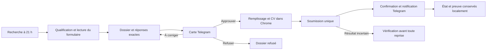

# Processus 2 — postuler à une offre

Ce processus recherche des missions, prépare un dossier individuel, obtient sa validation Telegram et l'envoie. Il ne publie pas de contenu sur le profil ou la page LinkedIn.

## Règles du parcours

- Maroc, mobilité Casablanca/Rabat, tous modes de travail ; missions freelance en conseil IA, solutions IA et transformation digitale.
- Recherche quotidienne à 21 h `Africa/Casablanca`, maximum 20 nouveaux dossiers présentés par jour. Le quota n'impose pas de retenir des offres faibles.
- Sources : CV fixe, profil observé et précisions confirmées du candidat. La mémoire éditoriale des posts n'est pas la source des réponses de candidature.
- Carte Telegram : poste, destinataire, correspondance, écarts et synthèse ; bouton pour les réponses exactes. Le CV n'est pas joint au message Telegram.
- Approbation valable 24 h pour la version exacte, liée à l'empreinte du CV. Une modification du dossier demande une nouvelle validation.
- Dès réception de l'approbation, le service lance le worker. La lecture des sources, le remplissage, le transfert du CV et l'envoi compris dans cette approbation ne demandent pas une nouvelle confirmation.
- Comptes employeurs : création autorisée seulement si indispensable ; identifiants dans le fichier Markdown privé dédié, jamais dans les archives partageables ou Telegram.
- Champs obligatoires inconnus ou incompatibles, code inaccessible et CAPTCHA : intervention ciblée. Aucune réponse inventée ; aucune discussion financière.
- Une offre au contrat non précisé reste indiquée comme telle. Une exception explicitement autorisée pour proposer du freelance à un employeur reste limitée à ce dossier.
- Un message de confirmation visible permet de conclure à l'envoi. Un résultat incertain interdit un nouvel envoi aveugle.

## Composants actuels

| Élément | Emplacement ou commande |
| --- | --- |
| Moteur et état | `src/candidatures/`, `data/candidatures/state.sqlite3` |
| CV effectivement utilisé | `output/pdf/Naoufel_Chahid_CV_Francais_Candidatures.pdf` |
| Précisions confirmées | `data/candidatures/candidate_facts.json` — privé |
| Comptes employeurs | `data/candidatures/accounts.md` — privé |
| Contrôle Chrome | Playwright MCP en mode extension ; `scripts/playwright-mcp` |
| Recherche et reprise périodiques | Cron via `scripts/candidatures.sh` |
| Réception immédiate des décisions | `linkedin-candidatures-listener.service` |
| Diagnostic sans envoi | `python3 -m src.candidatures doctor` |
| État des dossiers | `python3 -m src.candidatures list` |

## Guides associés

- [Exploitation](exploitation.md) : configuration, commandes, planning et incidents.
- [Archivage](archivage.md) : versions conservées, export privé et limites de reprise historique.
- [Spécification](specification.md) : règles métier et contrôles techniques.
- [Cadrage historique](cadrage.md) : décisions de conception.
- [Test réel du 5 novembre 2026](test-process-2026-11-05.md) : parcours et confirmation de la première soumission.

Les anciens diagnostics décrivent des étapes passées. Ils ne doivent pas faire désactiver un connecteur fonctionnel ou relancer une candidature déjà envoyée.
