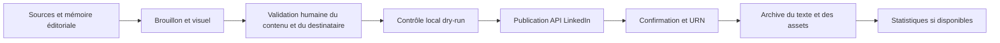

# Processus 1 — publier sur LinkedIn

Ce processus prépare un contenu éditorial, obtient sa validation, le publie et conserve sa trace. Il ne recherche pas d'offres et n'utilise pas le bot de candidatures.

## Parcours



1. Lire la [mémoire éditoriale](../../memoire-linkedin.md) et appliquer le [skill à quatre formats](../../.agents/skills/linkpost-quatre-formats/SKILL.md), en mode sans LinkPost.
2. Préparer le contenu dans `posts/drafts/`. Conserver les visuels, leurs textes alternatifs et les sources nécessaires. Les variantes et notes ne sont pas automatiquement des posts publiables.
3. Faire valider le texte final, les pièces jointes et la destination profil/page. Une validation de candidature dans Telegram n'autorise pas une publication.
4. Préparer le fichier contenant **uniquement le texte destiné à LinkedIn**, puis utiliser `dry-run`.
5. Exécuter `publish --confirm-publish` après validation explicite.
6. Après confirmation, appliquer le [guide d'archivage](archivage.md). Une erreur ou un résultat ambigu ne devient pas un post « publié ».

## Code et configuration actuels

- Client : [src/api/linkedin_client.py](../../src/api/linkedin_client.py).
- Configuration : `.env`, à partir de [.env.example](../../.env.example). La version API configurée doit être encore supportée ; la valeur d'exemple n'est pas une garantie de compatibilité future.
- Sources secondaires : `references/publications/positionnement/brief.json`, `references/publications/strategie/`, exports du profil. Les faits provisoires restent à vérifier contre la mémoire et les corrections utilisateur.
- Tests : [test_linkedin_client.py](../../tests/test_linkedin_client.py).

## Commandes

Depuis la racine du projet. `mon-post.txt` et les noms d'assets ci-dessous sont des exemples à remplacer par les fichiers préparés pour le post validé.

```bash
# Vérifier l'accès API en lecture seule
python3 src/api/linkedin_client.py auth

# Contrôler le texte sans publication
python3 src/api/linkedin_client.py dry-run --file posts/drafts/mon-post.txt

# Contrôler un post avec image
python3 src/api/linkedin_client.py dry-run \
  --file posts/drafts/mon-post.txt \
  --image posts/drafts/assets/mon-image.png \
  --alt-file posts/drafts/assets/mon-image.alt.txt

# Publier uniquement après validation humaine
python3 src/api/linkedin_client.py publish \
  --file posts/drafts/mon-post.txt --confirm-publish

# Consulter des statistiques ; l'accès dépend des permissions du jeton
python3 src/api/linkedin_client.py stats
python3 src/api/linkedin_client.py stats --post-urn 'urn:li:share:IDENTIFIANT'
```

Pour publier une image, utiliser les mêmes options `--image` et `--alt-file` que lors du contrôle. Le client exige un texte alternatif. Un document avec notes peut délimiter le texte publiable par `<!-- linkedin:post:start -->` et `<!-- linkedin:post:end -->` : seule cette section est extraite. Sans ces marqueurs, fournir uniquement le texte final ; un en-tête YAML est refusé.

## Limites actuelles

- Aucun planning de publication n'est installé dans le cron de ce projet.
- La CLI journalise et archive les nouvelles publications. `python3 src/api/linkedin_client.py archive` reprend l'export local sans appel API. Le retrait du brouillon actif et le classement des statistiques restent manuels.
- Les modules Ads/analytics vides ont été retirés ; aucun troisième processus n’est installé.
- Le travail sur le profil, la stratégie et les études éditoriales soutient ce processus ; il doit être classé séparément des brouillons de posts.
