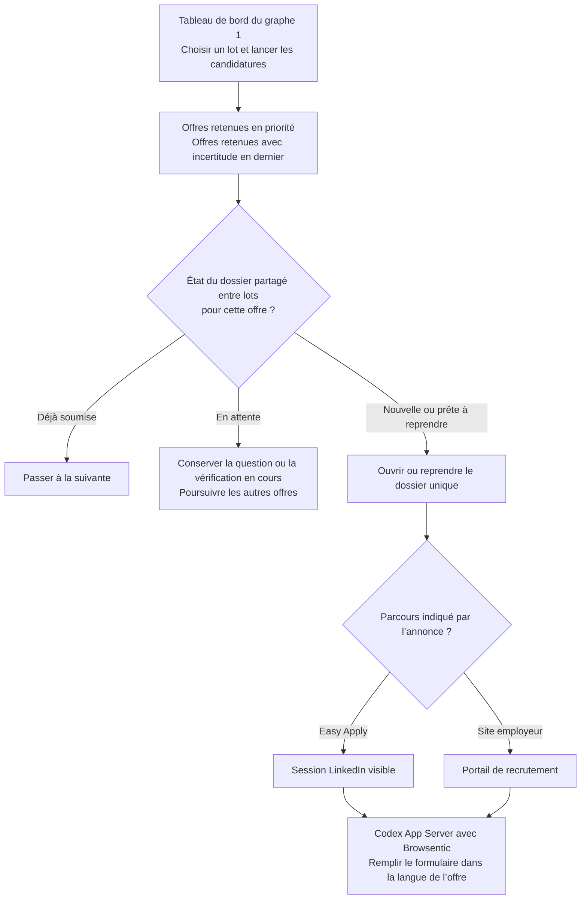
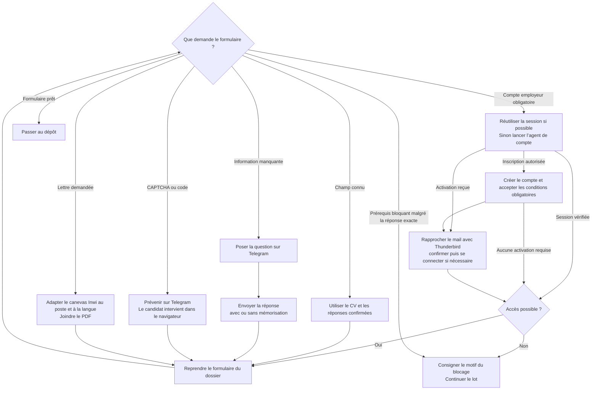
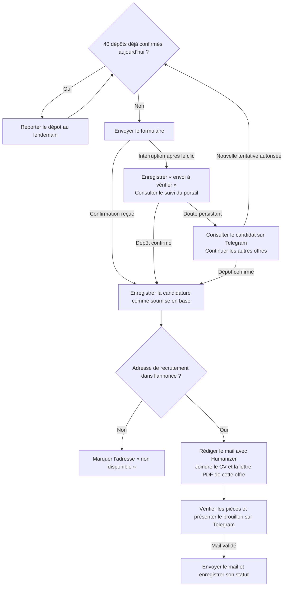

# Graphe 2 — Soumission des candidatures

## Lancement du lot

## Formulaire et reprises

## Dépôt et mail au recruteur

Une attente Telegram suspend uniquement le dossier concerné. Un envoi à vérifier ne réserve aucune place dans le seuil quotidien. Une confirmation tardive peut porter le total au-delà de 40. Le mail de suivi est réservé avant l’appel Thunderbird et n’est pas renvoyé automatiquement s’il reste incertain. Le code actuel ne réconcilie pas cette issue par une recherche dans les messages envoyés. Une interruption avant la soumission de l’inscription peut aussi laisser sa réservation sans reprise en écriture. Pour les autres écarts entre cette vue cible et le code, consulter l’[état de l’implémentation](../README.md#état-du-code).
